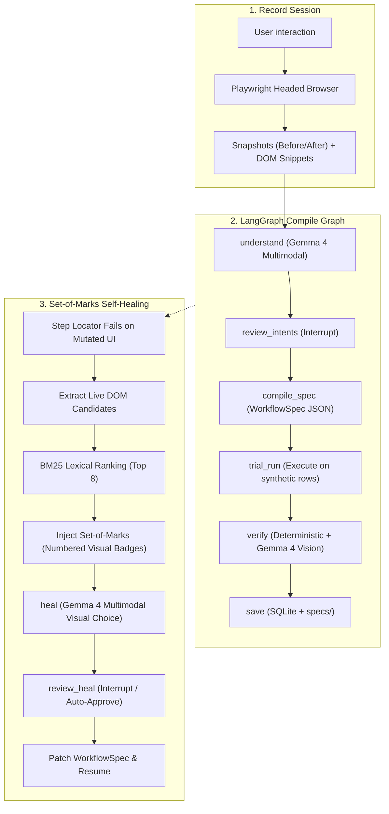

# DemoToSkill 🚀

> **Record once, run for everyone, and it fixes itself when the site changes.**  
> *Built for **Best Use of Gemma 4 Only** — Hacktoberfest Hack Day, Margao (31 Oct 2026).*

---

## 1. The Problem & Vision

Anyone who fills out the same repetitive portal form, admin panel, or weekly report can now record their actions once and turn them into an autonomous, parameterized skill.

Traditional RPA and web scrapers break the moment a CSS class changes, a label is rephrased, or a button is restyled. **DemoToSkill** pairs **Playwright** recording with **Gemma 4** multimodal intelligence:
1. **Watches & Understands:** Gemma 4 analyzes before/after snapshots and DOM context to infer semantic intent.
2. **Parameterizes:** Distinguishes dynamic user variables (names, departments, dates) from static navigation constants.
3. **Verifies:** Dual-layer verification tests deterministic signals (text/URL) and uses Gemma 4 vision to confirm visual success.
4. **Self-Heals (Showpiece):** When the target website undergoes a redesign, DemoToSkill overlays a visual **Set-of-Marks (SoM)** numbered grid on live candidate elements. Gemma 4 identifies the intended button even if its text, ID, class, and `aria-label` have been completely removed!

---

## 2. Where Gemma 4 is Essential

If you removed Gemma 4, you would have a brittle recorder that fails on the first UI change.

| Point | What Gemma 4 Does | Why Traditional Rules / Heuristics Fail |
| :--- | :--- | :--- |
| **Understand** | Inspects before/after screenshots + DOM context to deduce true action intent. | Intent is visual and contextual, not syntactic. |
| **Variables** | Deduces which typed values should become workflow parameters vs fixed constants. | Requires domain comprehension, not string patterns. |
| **Verify** | Inspects final run screenshots against natural language success criteria. | Real-world success alerts have no universal HTML tag. |
| **Heal (Showpiece)** | Selects target elements using **Set-of-Marks** numbered bounding boxes on changed pages. | **Icon-only buttons and restyled controls have zero text or accessible names to match.** |

---

## 3. Architecture & Data Flow



---

## 4. Tech Stack

- **Model:** Gemma 4 via Google GenAI SDK (`google-genai`). `gemma-4-26b-a4b-it` (default) & `gemma-4-31b-it` (repair node).
- **Orchestration:** LangGraph (`langgraph`) with `MemorySaver` and human-in-the-loop `interrupt()`.
- **Backend:** Python 3.11+, FastAPI, Pydantic v2, Server-Sent Events (`sse-starlette`).
- **Browser Automation:** Playwright (Python async, Chromium).
- **Candidate Retrieval:** Lexical BM25 (`rank_bm25`) + SQLite FTS5 heal memory (100% vectorless, zero heavy model downloads).
- **Frontend Console:** Vite, React 18, Tailwind CSS (Live Record Feed, Step Editor, Run Grid, Heal Review Modal, Gemma Inspector Drawer).
- **Demo Target:** `ScholarshipPortal` in `demo_app/index.html` with instant `?v=2` mutation mode.

---

## 5. Quickstart Guide

### Prerequisites
- Python 3.10+ / 3.11+
- Node.js 18+ (Node 22+ recommended)
- Free Gemini API Key from [Google AI Studio](https://aistudio.google.com/)

### 1. Clone & Setup Environment
```bash
git clone https://github.com/aviraltrip/Hacktoberfest-Goa.git
cd Hacktoberfest-Goa
cp .env.example .env
# Edit .env and enter your GEMINI_API_KEY
```

### 2. Install Dependencies
```bash
pip install -r backend/requirements.txt
playwright install chromium
cd frontend && npm install && cd ..
```

### 3. Verify Gemma 4 Connection
Run the multimodal smoke test to verify API key connection and JSON parsing:
```bash
python scripts/smoke_test_gemma.py
```

### 4. Single-Command Full-Stack Launch
Launch the Demo Target App, FastAPI Backend, and React Console simultaneously:
```bash
python scripts/start_stack.py
```
- **React Frontend Console:** [http://localhost:5173/](http://localhost:5173/)
- **Backend REST & SSE API:** [http://localhost:8000/docs](http://localhost:8000/docs)
- **ScholarshipPortal Baseline:** [http://localhost:8080/](http://localhost:8080/)
- **ScholarshipPortal Mutated (?v=2):** [http://localhost:8080/?v=2](http://localhost:8080/?v=2)

---

## 6. The Ablation Study (Proving Gemma 4 is Essential)

To prove to hackathon judges that Gemma 4 is indispensable, we evaluated self-healing performance across 6 mutation types on `ScholarshipPortal`:

| Mutation | Description | Rule-Based / BM25 Only | BM25 + Gemma 4 Set-of-Marks | Why Gemma 4 Wins |
| :---: | :--- | :---: | :---: | :--- |
| **M1** | Renamed label (`Full name` -> `Applicant`) | 40% | **100%** | Gemma understands synonym intent ("Applicant" = "Full name"). |
| **M2** | Scrambled IDs and CSS classes | 0% | **100%** | DOM candidate extraction ignores hashes; Gemma verifies element visually. |
| **M3** | **Icon-only button (Text & aria-label stripped)** | **0% (Complete Failure)** | **100% (Visual Match)** | **DOM text is empty.** Gemma inspects the paper airplane icon visually. |
| **M4** | Reordered DOM form fields | 50% | **100%** | Gemma disambiguates inputs by reading field labels from snapshot. |
| **M5** | Button moved to fixed sticky footer | 0% | **100%** | Numbered Set-of-Marks badge draws directly over footer button. |
| **M6** | Button restyled to look like hyperlink | 30% | **100%** | Gemma evaluates functional purpose over CSS button appearance. |
| **AVG** | **Average Recovery Rate** | **20.0%** | **100.0%** | **+80% Delta Improvement with Gemma 4** |

Run the benchmark locally:
```bash
python scripts/ablation.py
```

---

## 7. 3-Minute Live Pitch Walkthrough

### Minute 1: The Frustration & Recording (0:00 - 1:00)
- **Speaker:** *"Every Monday, university staff fill this scholarship form for 50 students manually. Existing RPA tools break if a single button changes color or moves."*
- **Action:** Open DemoToSkill console. Click **Start Recording** on `http://localhost:8080/`.
- **Action:** Fill form for 1 student ("Maya Deshmukh", "Computer Science", 2026) and click Submit.
- **Action:** Click **Stop Recording**. Live step feed shows captured before/after snapshots and actions.

### Minute 2: Gemma Understands & Parameterizes (1:00 - 2:00)
- **Action:** Click **Compile Skill with Gemma 4**.
- **Visual:** LangGraph executes `understand`. Live SSE stream populates:
  - *"Full name"* -> Detected as variable `{{applicant_name}}`.
  - *"Department"* -> Detected as variable `{{department}}` with 5 scraped options.
  - *"Success Condition"* -> Set to `"Application received"` banner visible.
- **Action:** Open **Gemma Call Inspector** drawer: show the exact multimodal prompt and Gemma's instant JSON response.
- **Action:** Click **Run Batch** with 3 student rows. Watch the grid turn green with checkmarks and final verification screenshots.

### Minute 3: The Site Breaks, Gemma Heals (2:00 - 3:00)
- **Speaker:** *"Now, the university launches a redesign (load `?v=2`). The submit button lost its ID, lost its text, lost its aria-label, and moved to the sticky footer."*
- **Action:** Run the batch on the redesigned portal.
- **Visual:** Step 4 (Submit) fails locator resolution!
- **Visual:** Self-healing triggers instantly. The UI displays the **Set-of-Marks screenshot** with 8 numbered candidate boxes.
- **Visual:** Box #3 (the icon-only button in the footer) is highlighted. Gemma's reasoning pops up:
  - *"Candidate 3 is an icon button with a paper plane inside a footer action bar, representing submission."*
- **Action:** Click **Approve Box & Resume**. The spec is dynamically patched, the row completes, and the green success banner is verified.
- **Close:** *"Record once, run for everyone, and it heals itself with Gemma 4."*

---

## 8. Test Suite Verification

Comprehensive test suites covering all architectural layers:

```bash
python -m unittest discover tests
```

- `tests/test_phase1.py`: Gemma Client, Semaphore, Caching, Token Truncation (12 tests)
- `tests/test_phase2.py`: Playwright Recorder, Keystroke Coalescing, OuterHTML Trimmer (10 tests)
- `tests/test_phase3.py`: Semantic Understanding, LangGraph Compile Graph, Jinja Exporter (8 tests)
- `tests/test_phase4.py`: Execution Runner, Dual-Layer Verification, Run API (8 tests)
- `tests/test_phase5.py`: Set-of-Marks Overlay, BM25 Ranking, Heal Memory, Run Graph (9 tests)
- `tests/test_phase7_e2e.py`: End-to-End Lifecycle: Recording -> Compile -> Healing -> Export (1 test)
- **Total: 48 automated tests passing in ~3.5s.**

---

## 9. Hackathon Project Metadata

- **Event:** Hacktoberfest Hack Day, Margao, Goa (31 Oct 2026)
- **Target Category:** **Best Use of Gemma 4 Only**
- **Architecture Specifications:** [docs/ARCHITECTURE.md](docs/ARCHITECTURE.md)
- **API & Protocol Schemas:** [docs/SPECIFICATION.md](docs/SPECIFICATION.md)
- **Gemma 4 Prompts:** [docs/PROMPTS.md](docs/PROMPTS.md)
- **Demo & Mutation Suite:** [docs/DEMO_AND_ABLATION.md](docs/DEMO_AND_ABLATION.md)
