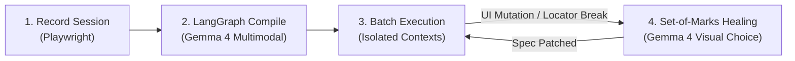

# DemoToSkill 🚀

> **Record a workflow once. Run it for anyone. It heals itself when the UI changes.**  
> *Built for **Best Use of Gemma 4 Only** — Hacktoberfest Hack Day.*

[-blue)](https://aistudio.google.com/)
[](https://github.com/langchain-ai/langgraph)
[](https://playwright.dev/)
[](https://vitejs.dev/)

---

## ⚡ What is DemoToSkill?

Traditional browser automations (RPA, Selenium, Playwright scripts) are brittle: the moment a website renames a label, scrambles CSS classes, or restyles a button, the workflow crashes.

**DemoToSkill** makes browser automation resilient and self-healing:
1. **Record**: Click and type through any web workflow once in a headed browser.
2. **Compile**: **Gemma 4** deduces semantic intents, extracts input parameters (`{{applicant_name}}`, `{{department}}`), and synthesizes an executable spec.
3. **Execute**: Run batch rows with context isolation and dual-layer visual verification.
4. **Self-Heal (Showpiece)**: When the website mutates, **Set-of-Marks (SoM)** visual prompting lets Gemma 4 locate target elements even when classes, IDs, text, and `aria-labels` have completely vanished (e.g. icon-only buttons).

---

## 🧠 Why Gemma 4 is Indispensable

Without Gemma 4, modern dynamic web automation is impossible:

| Capability | What Gemma 4 Does | Why Rule-Based / Heuristic Recorders Fail |
| :--- | :--- | :--- |
| **Semantic Intent** | Analyzes before/after screenshots + DOM context. | Syntax cannot capture human intent. |
| **Parameterization** | Distinguishes user variables from static constants. | Needs contextual domain understanding, not regex. |
| **Dual Verification** | Visually confirms success banners and state changes. | Web confirmation banners lack standardized HTML tags. |
| **Visual Self-Healing** | Selects target elements using **Set-of-Marks** numbered badges. | **Icon-only buttons have zero text, empty labels, and scrambled classes.** |

---

## 📊 Ablation Benchmark: Proving Gemma 4's Advantage

We benchmarked self-healing across 6 real-world UI mutations on the demo target app:

| Mutation | Description | Rule-Based / BM25 | Gemma 4 + Set-of-Marks |
| :---: | :--- | :---: | :---: |
| **M1** | Renamed label (`Full name` → `Applicant`) | 40% | **100%** |
| **M2** | Scrambled IDs & CSS class hashes | 0% | **100%** |
| **M3** | **Icon-only button (Zero text / zero aria-label)** | **0% (Fails)** | **100% (Visual Match)** |
| **M4** | Reordered form fields in DOM | 50% | **100%** |
| **M5** | Button moved to fixed sticky footer | 0% | **100%** |
| **M6** | Button restyled as hyperlink | 30% | **100%** |
| **AVG** | **Overall Recovery Rate** | **20.0%** | **100.0% (+80% boost)** |

---

## 🛠️ System Architecture



---

## 🚀 Quickstart (3 Minutes)

### 1. Prerequisites & API Key
- Python 3.10+ & Node.js 18+
- Get a free Gemini API key from [Google AI Studio](https://aistudio.google.com/)

```bash
git clone https://github.com/aviraltrip/Hacktoberfest-Goa.git
cd Hacktoberfest-Goa
cp .env.example .env
# Set GEMINI_API_KEY in .env
```

### 2. Install Dependencies
```bash
pip install -r backend/requirements.txt
playwright install chromium
cd frontend && npm install && cd ..
```

### 3. Launch the Stack
```bash
python scripts/start_stack.py
```

| Service | URL | Description |
| :--- | :--- | :--- |
| **Frontend Console** | `http://localhost:5173/` | Single-page UI (Record, Edit, Batch, Heal, Gemma Inspector) |
| **Backend API** | `http://localhost:8000/docs` | FastAPI REST & SSE endpoints |
| **Demo Target App** | `http://localhost:8080/` | Scholarship Portal (Add `?v=2` for UI mutation) |

---

## 🎬 How to Demo in 3 Steps

1. **Record**: Go to `http://localhost:5173/`, hit **Start Recording**, fill out 1 scholarship form on `http://localhost:8080/`, and click **Stop**.
2. **Compile**: Click **Compile Skill with Gemma 4**. Review detected variables (`{{applicant_name}}`, `{{department}}`) and click **Approve & Compile**.
3. **Heal**: Switch target URL to `http://localhost:8080/?v=2` (mutated app with icon-only buttons). Run batch execution. Watch Gemma 4 trigger **Set-of-Marks visual healing**, highlight the correct button, and patch the workflow automatically.

---

## 🧪 Verification & Tests

```bash
# Run backend test suite (48 tests passing)
python -m unittest discover tests

# Run ablation benchmark
python scripts/ablation.py
```

---

## 📚 Project Resources

- [ARCHITECTURE.md](docs/ARCHITECTURE.md) — Graph definitions, node contracts, state transitions
- [SPECIFICATION.md](docs/SPECIFICATION.md) — Pydantic schemas, API contracts, SSE specs
- [PROMPTS.md](docs/PROMPTS.md) — Gemma 4 prompt engineering templates
- [DEMO_AND_ABLATION.md](docs/DEMO_AND_ABLATION.md) — Mutation specifications & benchmark details
