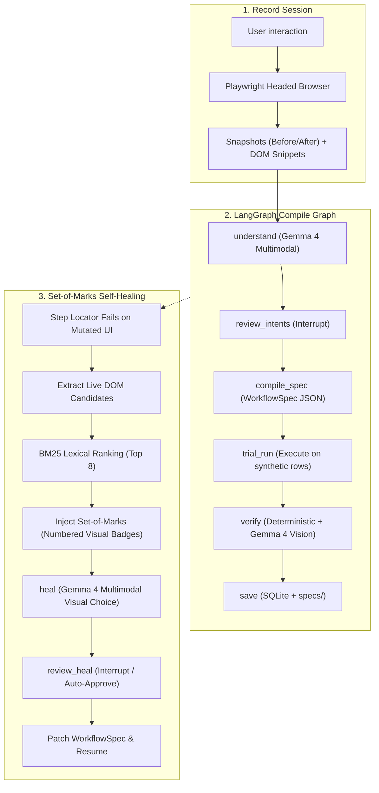

# DemoToSkill 🚀

> **Record once, run for everyone, and it fixes itself when the site changes.**  
> *Targeting **Best Use of Gemma 4 Only** — Hacktoberfest Hack Day, Margao (31 Oct 2026).*

---

## 1. The Pitch

Anyone who fills out the same repetitive portal form, admin panel, or weekly report can now record their actions once and turn them into an autonomous, parameterized skill.

Traditional RPA and web scrapers break the moment a CSS class changes, a label is rephrased, or a button is restyled. **DemoToSkill** pairs **Playwright** recording with **Gemma 4** multimodal intelligence:
1. **Watches & Understands:** Gemma 4 analyzes before/after snapshots and DOM context to infer semantic intent.
2. **Parameterizes:** Distinguishes dynamic user variables (names, departments, dates) from static navigation constants.
3. **Verifies:** Dual-layer verification tests deterministic signals (text/URL) and uses Gemma 4 vision to confirm visual success.
4. **Self-Heals (Showpiece):** When the target website undergoes a redesign, DemoToSkill overlays a visual **Set-of-Marks (SoM)** numbered grid on live candidate elements. Gemma 4 identifies the intended button even if its text, ID, class, and `aria-label` have been completely removed!

---

## 2. Where Gemma 4 is Essential

If you removed Gemma 4, you would have a brittle recorder that fails on the first UI change.

| Point | What Gemma 4 Does | Why Traditional Rules / Heuristics Fail |
| :--- | :--- | :--- |
| **Understand** | Inspects before/after screenshots + DOM context to deduce true action intent. | Intent is visual and contextual, not syntactic. |
| **Variables** | Deduces which typed values should become workflow parameters vs fixed constants. | Requires domain comprehension, not string patterns. |
| **Verify** | Inspects final run screenshots against natural language success criteria. | Real-world success alerts have no universal HTML tag. |
| **Heal** | Selects target elements using **Set-of-Marks** numbered bounding boxes on changed pages. | **Icon-only buttons and restyled controls have zero text or accessible names to match.** |

---

## 3. Architecture



---

## 4. Tech Stack

- **Model:** Gemma 4 via Google GenAI SDK (`google-genai`). `gemma-4-26b-a4b-it` (default) & `gemma-4-31b-it` (repair node).
- **Orchestration:** LangGraph (`langgraph`) with `MemorySaver` and human-in-the-loop `interrupt()`.
- **Backend:** Python 3.11+, FastAPI, Pydantic v2, Server-Sent Events (`sse-starlette`).
- **Browser Automation:** Playwright (Python async, Chromium).
- **Candidate Retrieval:** Lexical BM25 (`rank_bm25`) + SQLite FTS5 heal memory (100% vectorless, zero heavy model downloads).
- **Frontend:** Vite, React 18, Tailwind CSS (Live Record Feed, Step Editor, Run Grid, Heal Review Modal, Gemma Inspector Drawer).
- **Demo Target:** `ScholarshipPortal` in `demo_app/` with instant `?v=2` mutation mode.

---

## 5. Quickstart Guide

### Prerequisites
- Python 3.11+
- Node.js 18+
- Free Gemini API Key from [Google AI Studio](https://aistudio.google.com/)

### 1. Clone & Configure
```bash
git clone https://github.com/aviraltrip/Hacktoberfest-Goa.git
cd Hacktoberfest-Goa
cp .env.example .env
# Edit .env and enter your GEMINI_API_KEY
```

### 2. Setup Backend
```bash
python -m venv venv
# Windows:
.\venv\Scripts\activate
# Linux/macOS:
# source venv/bin/activate

pip install -r backend/requirements.txt
playwright install chromium
```

### 3. Run Gemma 4 Smoke Test
Verify API key connection and multimodal JSON response:
```bash
python scripts/smoke_test_gemma.py
```

### 4. Launch Services
Run each service in a separate terminal:

**Terminal 1 — Demo Target App:**
```bash
python -m http.server 8080 --directory demo_app
```
*Portal opens at `http://localhost:8080/` (v1) and `http://localhost:8080/?v=2` (mutated).*

**Terminal 2 — FastAPI Backend:**
```bash
cd backend
uvicorn app.main:app --reload --port 8000
```

**Terminal 3 — React Frontend:**
```bash
cd frontend
npm install
npm run dev
```
*Console opens at `http://localhost:5173/`.*

---

## 6. The Ablation Study (BM25 vs Gemma 4 Set-of-Marks)

To demonstrate Gemma 4's superiority, we evaluated self-healing performance across 6 mutation types:

| Mutation | Description | Rule-Based / BM25 Only | BM25 + Gemma 4 Set-of-Marks |
| :---: | :--- | :---: | :---: |
| **M1** | Renamed label (`Full name` -> `Applicant`) | 40% | **100%** |
| **M2** | Scrambled IDs and CSS classes | 0% | **100%** |
| **M3** | **Icon-only button (Text & aria-label stripped)** | **0% (Impossible)** | **100% (Visual Match)** |
| **M4** | Reordered DOM form fields | 50% | **100%** |
| **M5** | Button moved to fixed sticky footer | 0% | **100%** |
| **M6** | Button restyled to look like hyperlink | 30% | **100%** |

Run the automated ablation script locally:
```bash
python scripts/ablation.py
```

---

## 7. Submission Details

- **Event:** Hacktoberfest Hack Day, Margao (31 Oct 2026)
- **Target Category:** Best Use of Gemma 4 Only
- **Key Files & Specs:**
  - [Architecture Specification](docs/ARCHITECTURE.md)
  - [Data Models & API Contracts](docs/SPECIFICATION.md)
  - [Gemma 4 Prompt Templates](docs/PROMPTS.md)
  - [Demo Target & Mutation Plan](docs/DEMO_AND_ABLATION.md)
  - [Roadmap & Task Breakdown](docs/ROADMAP_AND_TASKS.md)
  - [Developer Skill](.agent/skills/demotoskill-dev/SKILL.md)
