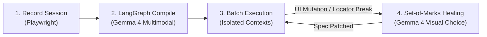

# DemoToSkill

> **Record a workflow once. Run it for anyone. It heals itself when the UI changes.**  

[-blue)](https://aistudio.google.com/)

---

## What is DemoToSkill?

Traditional browser automations (RPA, Selenium, Playwright scripts) are brittle: the moment a website renames a label, scrambles CSS classes, or restyles a button, the workflow crashes.

**DemoToSkill** makes browser automation resilient and self-healing:
1. **Record**: Click and type through any web workflow once in a headed browser.
2. **Compile**: **Gemma 4** deduces semantic intents, extracts input parameters (`{{applicant_name}}`, `{{department}}`), and synthesizes an executable spec.
3. **Execute**: Run batch rows with context isolation and dual-layer visual verification.
4. **Self-Heal (Showpiece)**: When the website mutates, **Set-of-Marks (SoM)** visual prompting lets Gemma 4 locate target elements even when classes, IDs, text, and `aria-labels` have completely vanished (e.g. icon-only buttons).

---

## Why Gemma 4 is Indispensable

Without Gemma 4, modern dynamic web automation is impossible:

| Capability | What Gemma 4 Does | Why Rule-Based / Heuristic Recorders Fail |
| :--- | :--- | :--- |
| **Semantic Intent** | Analyzes before/after screenshots + DOM context. | Syntax cannot capture human intent. |
| **Parameterization** | Distinguishes user variables from static constants. | Needs contextual domain understanding, not regex. |
| **Dual Verification** | Visually confirms success banners and state changes. | Web confirmation banners lack standardized HTML tags. |
| **Visual Self-Healing** | Selects target elements using **Set-of-Marks** numbered badges. | **Icon-only buttons have zero text, empty labels, and scrambled classes.** |

---

## 🛠️ System Architecture

