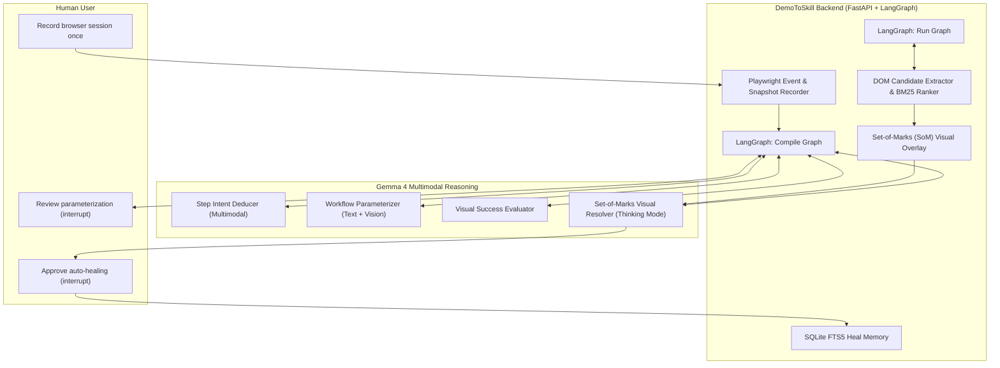
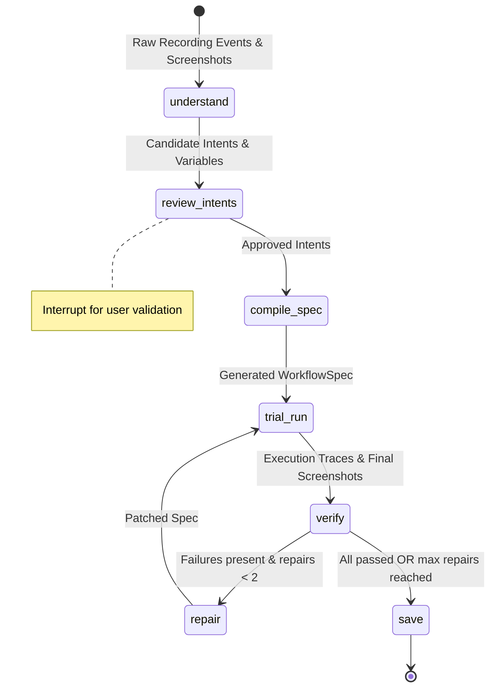
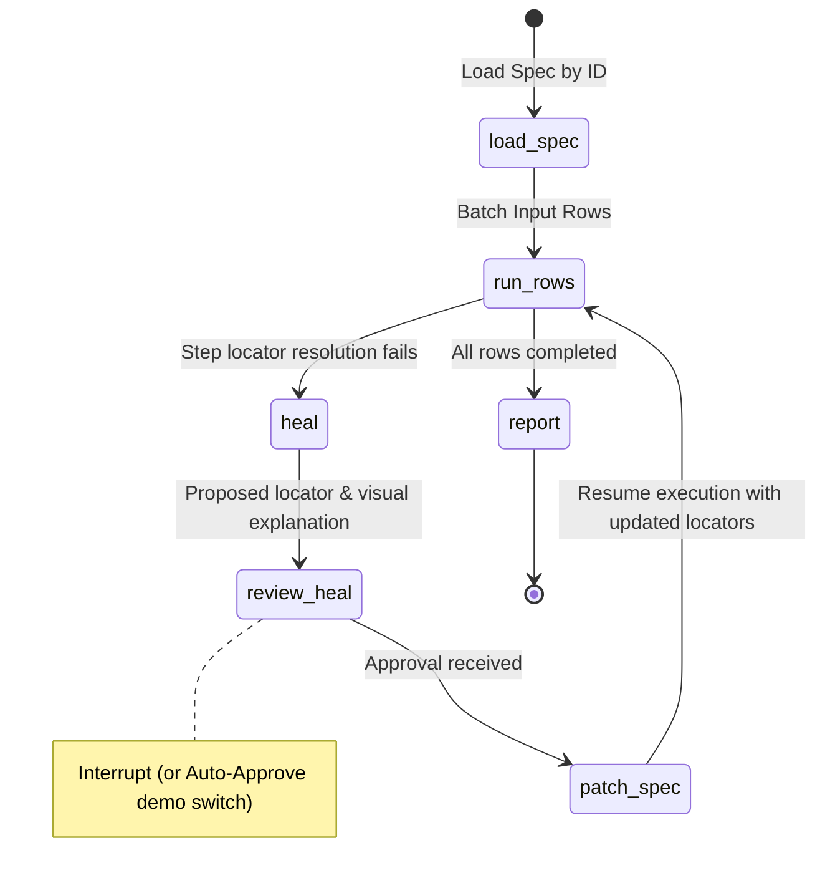
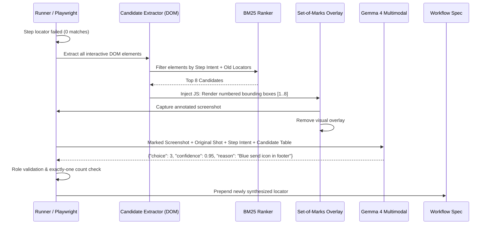
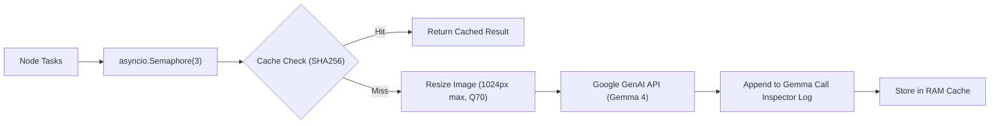

# DemoToSkill: System Architecture

## 1. High-Level Concept
DemoToSkill is an autonomous web workflow synthesizer and self-healing executor powered by **Gemma 4**. It transforms manual browser interactions into resilient, parameterized execution graphs ("skills") capable of surviving front-end structural and visual redesigns.

---

## 2. Graph Architectures (LangGraph)

Both graphs leverage LangGraph's `StateGraph`, `MemorySaver`, and checkpointing with `interrupt()` to support human-in-the-loop review.

### A. Compile Graph
Executed once immediately following a browser recording session.

#### Compile Graph Nodes
1. **`understand`**:
   - **Pass 1 (Per-Step Multimodal)**: Concurrently analyzes each step (`shot_before`, `shot_after`, DOM snippet, action) to determine semantic intent and whether the target is variable or constant.
   - **Pass 2 (Workflow Synthesis)**: Examines all step intents and final screenshot to extract the global workflow name, parameter schema, and natural language visual success criteria.
2. **`review_intents`**: LangGraph `interrupt()` node. Emits state to frontend for user confirmation of parameter names and defaults.
3. **`compile_spec`**: Compiles validated intents into a canonical `WorkflowSpec` JSON object. Generates Jinja2 standalone Playwright fallback script.
4. **`trial_run`**: Executes the compiled spec across 2–3 synthetic test rows in isolated browser contexts.
5. **`verify`**: Evaluates row execution:
   - Deterministic check: `url_contains` and `text_visible`.
   - Multimodal check: Gemma 4 inspects final screenshot against visual success criteria.
6. **`repair`**: Same underlying logic as the runtime `heal` node. Identifies why a step failed during trial run, locates candidate elements using Set-of-Marks, and repatches the spec.
7. **`save`**: Persists the finalized `WorkflowSpec` into SQLite and filesystem (`specs/`).

---

### B. Run Graph
Executed whenever a saved workflow is triggered with new input batches.

#### Run Graph Nodes
1. **`load_spec`**: Retrieves `WorkflowSpec` from SQLite.
2. **`run_rows`**: Iterates through data rows. Isolates each execution in a clean browser context.
3. **`heal` (Shared with `repair`)**: Triggered upon step locator failure. Runs candidate extraction, BM25 filtering, Set-of-Marks overlay, and Gemma 4 visual selection.
4. **`review_heal`**: `interrupt()` node presenting the side-by-side marked screenshot, Gemma's rationale, and candidate details to the user.
5. **`patch_spec`**: Prepends the repaired locator to the step definition and records the heal event in `heals` SQLite FTS5 table.
6. **`report`**: Summarizes batch metrics, pass/fail status, and visual proof snapshots.

---

## 3. Healing & Set-of-Marks (SoM) Subsystem

The healing node is DemoToSkill's technological showpiece for the **Best Use of Gemma 4** prize. When a DOM redesign breaks traditional locators (e.g. an element loses text, ID, class, and aria-label):

### Key Technical Safeguards
1. **No Absolute Pixel Guessing:** Rather than asking Gemma 4 to predict pixel coordinates $(x, y)$, which small multimodal models struggle with, we inject numbered visual bounding markers directly into the page DOM. Gemma selects the integer ID (`1`–`8`).
2. **Role Compatibility Gate:** If the action is `fill`, the selected candidate must be an `input` or `textarea`. If `select`, it must be a dropdown.
3. **The "Exactly-One" Rule:** The newly synthesized locator must resolve to exactly 1 element on the live DOM before it is accepted.

---

## 4. Vectorless Retrieval Architecture (BM25 + FTS5)

In compliance with hackathon speed and simplicity:
- **No Vector DBs or Heavy Embedding Models:** Instead of downloading multi-gigabyte PyTorch/sentence-transformers models, DemoToSkill uses lexical BM25 (`rank_bm25`) over live DOM attributes.
- **Corpus:** The live page DOM. Interactive tags (`button`, `input`, `select`, `a`, `textarea`, `[role]`, `[tabindex]`).
- **Query:** `step.intent` + previous locator strings.
- **Heal Memory:** SQLite table `heals(site, intent, old_locator, new_locator, ts)` indexed with SQLite FTS5. Injects past heal hints into the prompt when a site has been repaired previously.

---

## 5. Concurrency & Gemma 4 Optimization

- **Image Downscaling:** Raw 1080p screenshots (~1.8 MB) are resized to width 1024px JPEG quality 70 (~120 KB), slashing latency by >60%.
- **SHA-256 Deduplication:** Repeated identical calls during trial runs or repairs are served from cache.
- **Global Concurrency Throttling:** `asyncio.Semaphore(3)` avoids HTTP 429 quota exhaustion on free Gemini API tiers.
