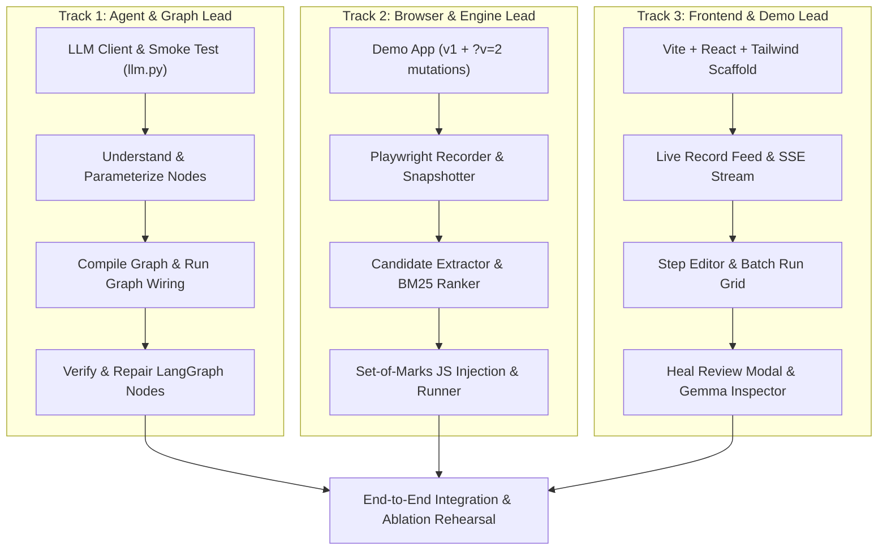

# DemoToSkill: Implementation Roadmap & Task Matrix

## 1. Hackathon Team Allocation (3 People, 8 Hours)

---

## 2. Hour-by-Hour Execution Plan

### Hour 0:00 - 0:45 | Foundation & Go/No-Go Gate
- [ ] Initialize repo structure, virtual environment, and install dependencies (`requirements.txt`, `npm install`).
- [ ] **Critical Go/No-Go Gate (Lead 1)**: Run `scripts/smoke_test_gemma.py`. Verify Gemma 4 multimodal image input + JSON response using `google-genai` SDK and `GEMINI_API_KEY`.
- [ ] Build baseline `demo_app/index.html` (Lead 2).
- [ ] Scaffold Vite React app with Tailwind CSS (Lead 3).

### Hour 0:45 - 2:30 | Core Recording & Understanding
- [ ] **Track 1**: Implement `backend/app/llm.py` (caching, semaphore, retry, call log) and `nodes/understand.py` (Pass 1 per-step & Pass 2 workflow).
- [ ] **Track 2**: Implement `backend/app/recorder.py` (injected recording listener, debounced inputs, settles, before/after downscaled screenshots).
- [ ] **Track 3**: Build UI panels: Header, Start/Stop Record button, and live SSE event feed displaying recorded steps and thumbnails.

### Hour 2:30 - 4:00 | Compilation & Execution Runner
- [ ] **Track 1**: Implement `nodes/compile_spec.py`, `nodes/trial_run.py`, `nodes/verify.py`, and wire `CompileState` graph in `graphs.py`.
- [ ] **Track 2**: Implement `backend/app/runner.py` (spec interpreter, locator resolution chain, batch row isolation).
- [ ] **Track 3**: Build Step Editor UI (modify variables, default values) and Run Grid (rows vs steps matrix with status indicators).

### Hour 4:00 - 5:30 | The Showpiece: Set-of-Marks Self-Healing
- [ ] **Track 1**: Implement `nodes/repair.py` with multimodal SoM prompt and LangGraph `interrupt()`.
- [ ] **Track 2**: Implement `backend/app/candidates.py` (DOM candidate extraction, BM25 ranking, dynamic JS bounding box overlay injection).
- [ ] **Track 3**: Build Heal Review screen (side-by-side comparison, numbered candidates overlay, Gemma's visual reasoning, Approve/Reject buttons) and the **Gemma Call Inspector** drawer.

### Hour 5:30 - 6:30 | Integration, Mutations & Ablation Harness
- [ ] Wire complete end-to-end flow: Record on `demo_app` -> Compile -> Run on normal site -> Switch to `?v=2` -> Auto-heal -> Verify.
- [ ] Implement `scripts/ablation.py` across the 6 mutations and generate real performance charts.
- [ ] Polish error states, animations, and tooltips.

### Hour 6:30 - 7:30 | Presentation Polish & Backup Assets
- [ ] Record a high-definition backup screencast video of the 3-minute demo (audio + video).
- [ ] Prepare presentation slides highlighting Gemma 4's visual perception and the ablation table.
- [ ] Rehearse live pitch twice.

### Hour 7:30+ | Submission Freeze
- [ ] Clean up git commit history and push to GitHub.
- [ ] Verify `README.md` and `.env.example`.
- [ ] Submit project link to hackathon portal.

---

## 3. Risk Mitigation & Feature Cut Hierarchy

If time runs short, features must be cut in strict order without compromising the core Gemma 4 value proposition:

1. **Cut 1 (First to drop)**: Standalone Python Playwright script export (`export_script.py`). The runner interprets JSON natively anyway.
2. **Cut 2**: Past heal memory (`memory.py` SQLite FTS5 lookup). Can be simulated or dropped with minimal impact.
3. **Cut 3**: Complex variable type inferencing (reduce all variables to string type).
4. **DO NOT CUT**:
   - `nodes/understand.py` (Shows Gemma parameterization).
   - `nodes/repair.py` with Set-of-Marks (The core winning feature).
   - `nodes/verify.py` visual inspection.
   - Gemma Call Inspector drawer (Proves Gemma 4 does real work to judges).

